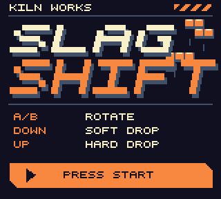
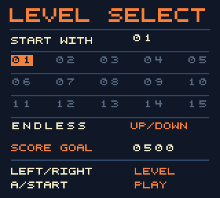
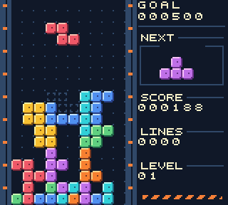

# Slag Shift

A falling-block puzzle for Game Boy Color and ModRetro Chromatic, built with GB Studio. Fill a horizontal row to clear it. A shuffled bag deals all seven shapes before it refills.

| Title screen | Level select | Gameplay |
| :---: | :---: | :---: |
|  |  |  |

Choose a numbered level or Endless before each run. In numbered play, earning 500 points on Level 1 and another 1,000 on Level 2 advances you through fresh opening stacks. Each level asks for 500 more points than the previous one. The HUD shows the score target for the current level. Unlocks save immediately. After the celebration, the next board starts at zero points and carries over your line count and upcoming piece. Higher levels fall faster and start with taller stacks. Every opening has an empty column down to the floor. Level 15 is the final board and continues until you top out.

Endless starts with an empty well and a steady fall speed. Stack pieces, clear lines, and play for score until the board fills. You can pause and press Select to return to the picker in either mode.

| Action | Handheld | Browser |
| --- | --- | --- |
| Move | Left / Right | Left / Right arrow |
| Rotate clockwise / counterclockwise | A / B | Z / X |
| Soft drop | Down | Down arrow |
| Hard drop and lock | Up | Up arrow |
| Open level select, start, pause, or resume | Start | Enter |
| Pick an unlocked level on the selection screen | Left / Right, then A or Start | Left / Right, then Z or Enter |
| Switch between numbered play and Endless | Up or Down | Up or Down arrow |
| Leave a paused run for level select | Select | P |

A soft drop earns one point per cell and a hard drop earns two. Clearing one, two, three, or four rows awards 100, 300, 500, or 800 points times the current level. The clear plays a four-note flourish that rises higher for multi-line clears.

“Banked Embers” plays on the title screen. “Rivet Run” begins with the first piece and pauses with the game. When the stack tops out, “Last Bell” sounds a metallic strike and a descending chime. It plays once, and you can restart during the cue. All three scores are editable in GB Studio under Music.

Open `project.gbsproj` in GB Studio. The playable scene uses the project's Slag Shift scene type. Its rules and renderer live in `plugins/slag-shift/engine/src/states/slagshift.c`. The title and HUD artwork are generated by `plugins/slag-shift/art/tiles.py` with Pillow.
